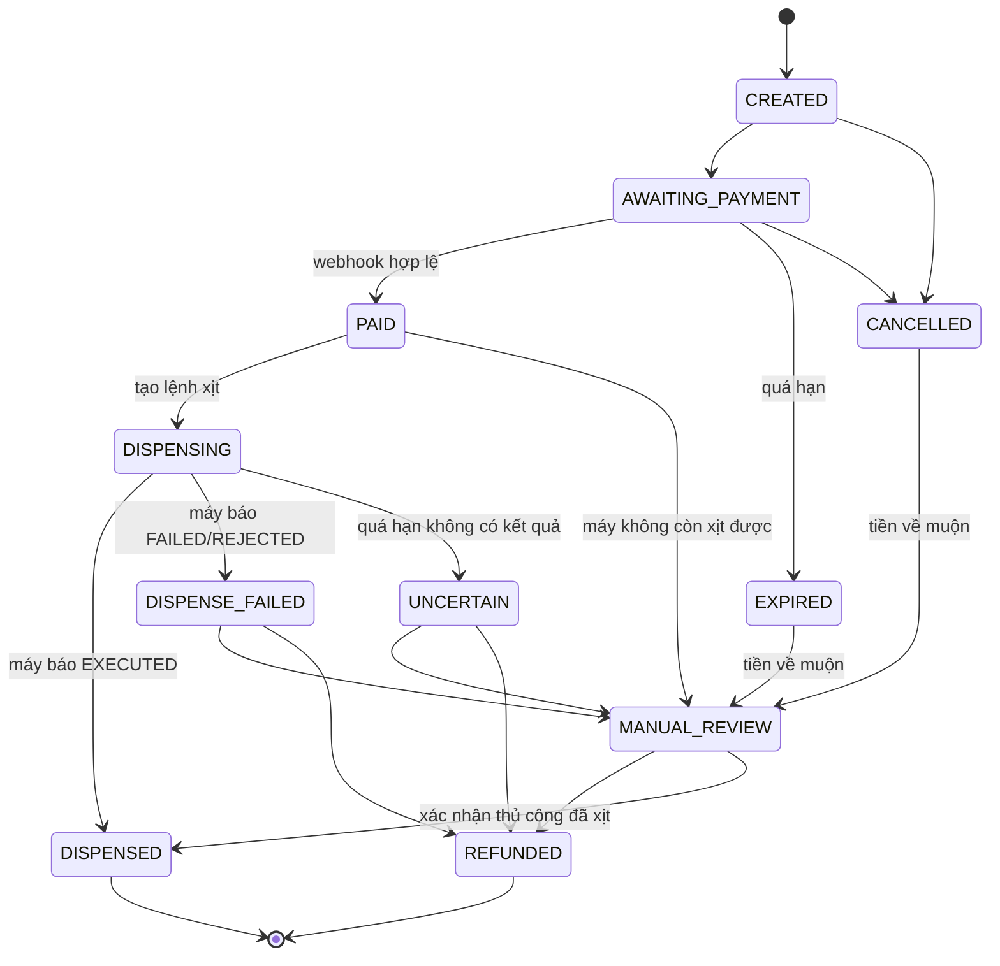
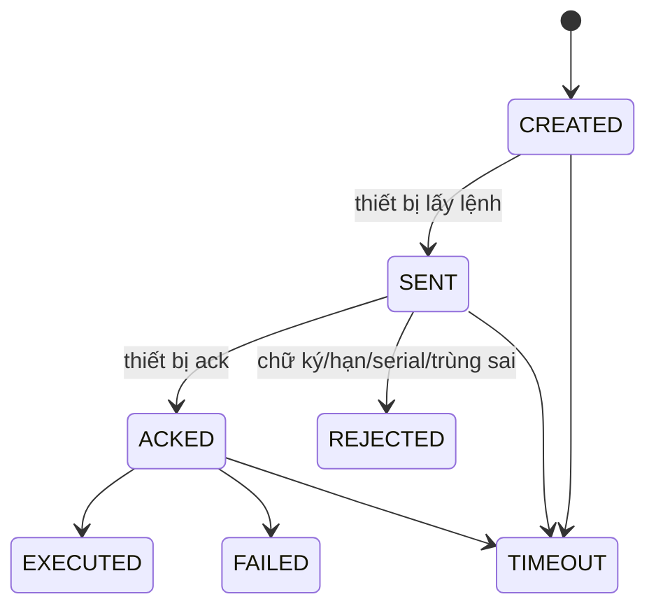
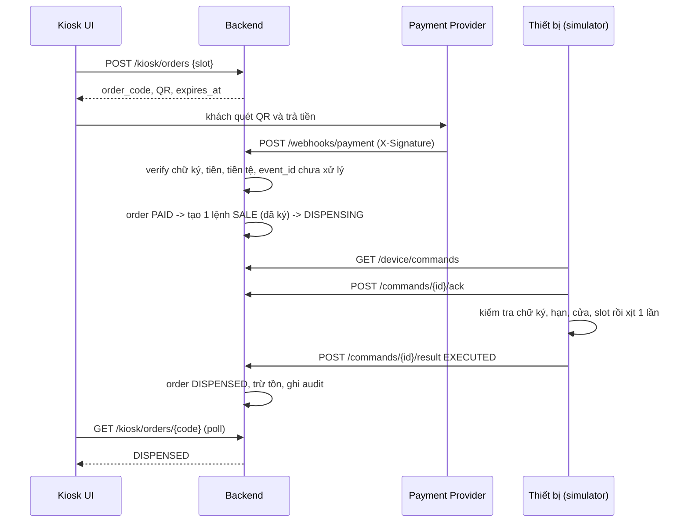

# State machines và luồng nghiệp vụ

Nguồn sự thật trong code: `src/domain/models/order_state_machine.py`, `src/domain/models/dispense_policy.py`, `src/domain/constants.py`.
Mọi thay đổi `order.status` **chỉ** đi qua `OrderWorkflow` và `assert_transition()`.

## 1. Trạng thái đơn hàng

Hai trạng thái cuối: `DISPENSED`, `REFUNDED`. Không có cạnh nào từ lỗi/không chắc chắn quay về `DISPENSING` ⇒ **không bao giờ tự xịt lần hai**.

## 2. Trạng thái lệnh xịt (`dispense_commands`)

Ràng buộc: `UNIQUE(order_id, type)` ⇒ một đơn có tối đa một lệnh SALE. Chữ ký HMAC trên `command_id|serial|slot|type|expires_at`.

## 3. Chuỗi xử lý thanh toán → xịt (sequence)

## 4. Các trạng thái khác

| Đối tượng | Giá trị | Ghi chú |
|---|---|---|
| Máy (kết nối) | ONLINE / UNSTABLE / OFFLINE | Tính từ heartbeat cuối so với `HEARTBEAT_ONLINE_SECONDS` |
| Máy (chế độ) | NORMAL / MAINTENANCE / DISABLED | MAINTENANCE → NORMAL cần `post_test_passed` |
| Slot | AVAILABLE / LOW / EMPTY / DISABLED / ERROR | Dẫn xuất từ tồn ước tính và ngưỡng thấp |
| Chai | AVAILABLE / INSTALLED / NEARLY_EMPTY / EMPTY / DAMAGED / EXPIRED | |
| Cảnh báo | OPEN → ACKNOWLEDGED → ASSIGNED → RESOLVED ⇄ REOPENED | Chống trùng bằng `dedup_key` |
| Thanh toán | WAITING / SUCCESS / FAILED / CANCELLED / EXPIRED | |
| Hoàn tiền | REQUESTED / APPROVED / COMPLETED / REJECTED | |

## 5. Khi nào kiosk được bán (policy)

Đơn chỉ được tạo khi **tất cả** đúng: tenant ACTIVE · máy ONLINE · chế độ NORMAL · cửa đóng · không có lỗi nghiêm trọng · slot AVAILABLE/LOW và còn đủ nước hoa cho một lần xịt · slot có sản phẩm và giá. Sai một điều kiện ⇒ từ chối tạo đơn với thông báo rõ ràng (`assert_can_accept_order`).

## 6. Bảng kịch bản lỗi và kết quả mong đợi

| # | Tình huống | Hệ thống làm gì |
|---|---|---|
| 1 | Webhook gửi hai lần | Lần 2 trả `duplicate_ignored`, không tạo lệnh thứ hai |
| 2 | Sai chữ ký | 401, không đổi trạng thái |
| 3 | Số tiền/tiền tệ không khớp | 422, đơn giữ AWAITING_PAYMENT |
| 4 | Trả tiền sau khi đơn hết hạn | Đơn → MANUAL_REVIEW (không xịt) |
| 5 | Máy mở cửa lúc có lệnh | Thiết bị REJECTED/FAILED → DISPENSE_FAILED → MANUAL_REVIEW |
| 6 | Máy không báo kết quả | Job quá hạn → UNCERTAIN → MANUAL_REVIEW, không tự thử lại |
| 7 | Hoàn tiền khi chưa step-up | 403 |
| 8 | Brand B đọc dữ liệu brand A | 404 |
| 9 | Máy bị thu hồi gọi API | 401 |
